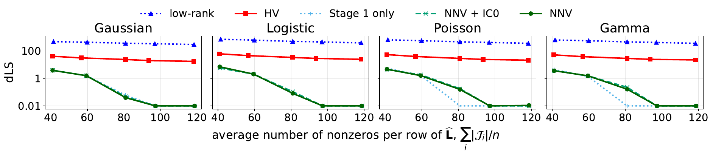
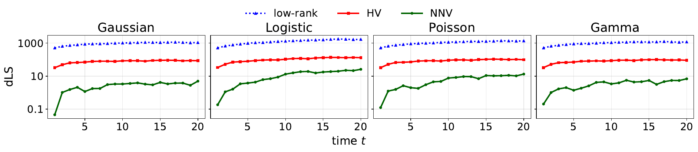
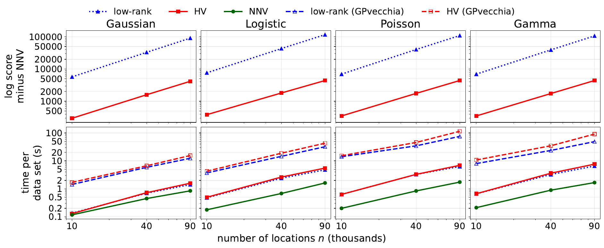

<h1 align="center">Nearest-Neighbor Vecchia Filter (NNV)</h1>

<p align="center">
  <em>Reproducible code for “Nearest-Neighbor Sparse Cholesky Decomposition with Applications to
  High-Dimensional Spatio-Temporal Filtering”</em>
</p>

<p align="center">
  
  
  
  
  
  
</p>

<p align="center">
  <a href="#highlights">Highlights</a> ·
  <a href="#setup">Setup</a> ·
  <a href="#reproducing-the-results">Reproducing the results</a> ·
  <a href="#where-each-table-and-figure-comes-from">Tables &amp; figures</a> ·
  <a href="#repository-layout">Layout</a>
</p>

This repository contains the code that produces every numerical result, table and figure in the
manuscript and its Supplementary Material:
- the **methodology figures** of Section 2 (sparsity patterns and implied basis functions);
- the **simulation study**: Section 3 of the manuscript and Section S6 of the supplement;
- the **MIRS total precipitable water application**: Section 4 and Section S7.

Two shell scripts run the whole workflow, from the data to the final table and figures.

A filter for a high-dimensional state-space model needs a sparse factor of the posterior
**covariance** matrix for its forecast step, but a nearest-neighbor Vecchia approximation gives a
sparse factor of the **precision** matrix. NNV turns the one into the other in three stages:

1. **Stage 1:** a forward-KL-optimal Vecchia factor $\mathbf{U}$ of the prior precision on the
   nearest-neighbor pattern $\mathbf{S}_\rho$;
2. **Stage 2:** incomplete Cholesky (IC0) of the sparse posterior precision
   $\mathbf{U}\mathbf{U}^\top + \mathbf{D}$, giving $\mathbf{V}$;
3. **Stage 3:** a sparse approximate inverse $\widehat{\mathbf{L}} \approx \mathbf{V}^{-\top}$
   on the support pattern $\mathbf{S}^L_\rho$, row by row, in closed form and in parallel.

The covariance factor $\widehat{\mathbf{L}}$ gives forecast covariances and samples without any
global linear solve. Non-Gaussian data are handled by a Laplace approximation.

---

## Highlights

### Close to the exact posterior at every sparsity level

<p align="center">
  
  <br>
  <sub><b>Manuscript Figure 4.</b> Spatial-only comparison (n = 1,600): difference in log score
  (dLS) from the exact posterior against the average number of nonzeros per row of the posterior
  covariance factor, for NNV, its stages, HV and low-rank.</sub>
</p>

<p align="center">
  
  <br>
  <sub><b>Manuscript Figure 5.</b> Filtering with linear advection–diffusion dynamics (n = 1,600):
  dLS of the filtering distributions over 20 time points.</sub>
</p>

### Scales to large grids

<p align="center">
  
  <br>
  <sub><b>Manuscript Figure 6.</b> All methods at about 80 nonzeros per row, n up to 90,000: log
  score of HV and low-rank minus that of NNV (top) and time per data set (bottom), including
  HV and low-rank in GPvecchia.</sub>
</p>

---

## Setup

Run every command from the root of this repository.

```bash
git clone https://github.com/pratiknag/NNV.git
cd NNV
bash setup.sh
```

[`setup.sh`](setup.sh) creates the Python environment `env/` with the packages of
[`requirements.txt`](requirements.txt) (Python ≥ 3.10; PyTorch from the CPU wheel index) and
installs the R packages `GPvecchia`, `fields` and `Matrix` (from GitHub if `GPvecchia` is not on
CRAN). `SKIP_PY=1` or `SKIP_R=1` skips one of the two parts, and `PYTHON_BIN` selects the
interpreter used for `env/`.

You also need R (≥ 4.1), git, a C/C++ compiler, and Arial or a metric-compatible font such as
Liberation Sans (for Figure 2).

> [!NOTE]
> No GPU is needed. All results were computed on an Intel Core i9-14900 CPU (32 threads) with
> 125 GB of RAM, using Python 3.11.5 and R 4.3.3 (GPvecchia 0.1.8). The exact Kalman filter of
> the application needs about **60 GB** of RAM. Everything else fits in 16 GB.

---

## Data

- **Simulations:** generated by the code.
- **Application:** [`data/MIRS.csv.gz`](data/) is included (8 MB). It is the MIRS total
  precipitable water data used by Jurek and Katzfuss (2022), from
  [katzfuss-group/vecchiaFilter](https://github.com/katzfuss-group/vecchiaFilter)
  (`data-application/MIRS.csv`).

---

## Reproducing the results

```bash
mkdir -p logs
setsid nohup bash run_simulations.sh > logs/run_simulations.log 2>&1 < /dev/null &
# after it has finished:
setsid nohup bash run_application.sh > logs/run_application.log 2>&1 < /dev/null &
```

| Script | What it does | Runtime |
|---|---|:---:|
| [`run_simulations.sh`](run_simulations.sh) | Figures 2–3, simulation study: data, exact posterior and Kalman filter, NNV, HV and low-rank, GPvecchia timings, figures | ≈ 6 h |
| [`run_application.sh`](run_application.sh) | MIRS application: data, GPvecchia patterns, NNV, HV and low-rank filters, exact Kalman filter, table and figures | ≈ 1.5 h |

All figures are written to `figures/`.

> [!TIP]
> - **Logs.** Each stage writes its log to `logs/`.
> - **Resuming.** An interrupted run is resumed by starting the script again. Stages whose
>   outputs exist are skipped. Figures are always redrawn.
> - **`FORCE=1`** regenerates the data and reruns every stage.
> - **`DRY_RUN=1`** prints every command without running it.
> - **`SKIP_EXACT=1`** (application) skips the exact Kalman filter. Figures 8 and S7 are still
>   drawn, but Table 1 and Figures 7 and S8 need the exact filter.

> [!IMPORTANT]
> Computation times are part of the results (Figures 6, 7, S6, Table 1). Run the two scripts
> one after the other, not at the same time, and do not run other heavy jobs alongside them.
> All data and scores use fixed seeds. The times depend on the hardware and will differ from the
> reported ones; multithreaded floating-point sums can change the scores in the last digits.

<details open>
<summary><b>Stages of <code>run_simulations.sh</code></b></summary>

All simulations use an exponential covariance with range 0.15 on regular grids of [0, 1]², and
four data models: Gaussian, Bernoulli–logistic, Poisson and gamma. NNV, HV and low-rank (LR) run
in the same Numba code; HV and LR take their orderings and conditioning sets from GPvecchia. The
methods are matched on the average number of nonzeros per row of the posterior covariance
factor.

1. **Methodology figures.** Figure 2 (`patterns.R`) and Figure 3
   (`basis_functions_comparison.py`, Matérn smoothness 1.5).
2. **Data** at n = 1,600 (40 × 40 grid), 10 data sets per data model:
   - spatial-only (`generate_Gaussian_datasets.R`);
   - advection–diffusion filtering, T = 20, 10% of the cells observed
     (`generate_advdiff_datasets.R`).
3. **Matched sparsity levels** (about 40, 60, 80, 100 and 120 nonzeros per row):
   GPvecchia patterns (`export_patterns_sweep.R`), then the exact posterior and Kalman filter,
   NNV, NNV + IC0, Stage 1 only, HV and LR (`sim_sparsity.py`). Figures 4–5, S2–S3, S5
   (`plot_sparsity.py`).
4. **Boundary maps.** Exact and HV posterior means in GPvecchia (`export_spatial_fields.R`) and
   NNV (`plot_spatial_maps.py`) for one logistic and one Poisson data set. Figures 1 and S1.
5. **Large n** at about 80 nonzeros per row:
   - spatial-only on 100 × 100, 200 × 200 and 300 × 300 grids, 10 data sets
     (`large_n_spatial.py`);
   - filtering on the 300 × 300 grid (n = 90,000), 10 data sets, T = 10
     (`large_n_filter.py`);
   - HV and LR in GPvecchia on the same data, for the time comparison (`large_n_gpvecchia.R`);
   - Figures 6, S4, S6 (`plot_large_n80.py`).

</details>

<details open>
<summary><b>Stages of <code>run_application.sh</code></b></summary>

1. **Data** (`mirs_prepare.py`). The inner 247 × 247 cells (n = 61,009) of the western
   263 × 263 part of the MIRS grid, 11 consecutive days; a random 10% of the observations at
   each time point are held out.
2. **GPvecchia patterns** of HV (requested m = 393) and LR (N = 307)
   (`export_patterns_sweep.R`).
3. **Filters** (`mirs_validate7.py`): NNV (ρ = 5, Stage 2 on the pattern of
   **U**·**U**ᵀ), HV and LR, all at about 300 nonzeros per row. Model: linear trend, exponential
   initial and innovation covariances with variances 54 and 10 and range 0.2, noise variance
   0.0697, diffusion 4.37 × 10⁻⁸, advection 1.60 × 10⁻⁴. Writes the held-out scores and the
   filtering means and standard deviations.
4. **Exact Kalman filter** with dense matrices, updated in place (`mirs_exact_full.py`,
   ≈ 40 min, ≈ 60 GB of RAM).
5. **Table and figures.** Table 1 and Figures 7 and S8 (`mirs_exact_plot.py`), Figures 8 and S7
   (`mirs_maps.py`).

</details>

---

## Where each table and figure comes from

All paths are written by the run scripts.

<details open>
<summary><b>Manuscript</b></summary>

| Item | Content | Output file | Results it is drawn from |
|---|---|---|---|
| Figure 1 | boundary effects, logistic data | `figures/spatial-maps-logistic.pdf` | `simulation_logistic/fields_seed1_n1600.csv` |
| Figure 2 | sparsity patterns | `figures/patterns.pdf` | — |
| Figure 3 | implied prior basis functions | `figures/basis-functions.pdf` | — |
| Figure 4 | spatial-only dLS against sparsity | `figures/sparsity-spatial.pdf` | `results_sparsity/spatial.csv` |
| Figure 5 | filtering dLS over time | `figures/sparsity-filter-time.pdf` | `results_sparsity/filter.csv` |
| Figure 6 | large n, spatial-only | `figures/large-n-spatial80.pdf` | `large_n/spatial80_side*.csv`, `large_n/gpvecchia80_side*.csv` |
| Table 1 | application, comparison with the exact filter | `application_mirs/results/table_exact.tex` | `application_mirs/results/scores_random_*.csv` |
| Figure 7 | application, RRMSPE, dLS and time per step | `figures/application-exact.pdf` | as Table 1 |
| Figure 8 | application maps, NNV and HV | `figures/application-maps.pdf` | `application_mirs/results/fields_random_{NNV,HV}.npz` |

</details>

<details>
<summary><b>Supplementary Material</b></summary>

| Item | Content | Output file |
|---|---|---|
| Figure S1 | boundary effects, Poisson data | `figures/spatial-maps-poisson.pdf` |
| Figure S2 | spatial-only RRMSPE against sparsity | `figures/sparsity-spatial-rmspe.pdf` |
| Figure S3 | filtering RRMSPE over time | `figures/sparsity-filter-time-rmspe.pdf` |
| Figure S4 | large n, spatial-only RMSPE | `figures/large-n-spatial80-rmspe.pdf` |
| Figure S5 | filtering at all sparsity levels | `figures/sparsity-filter.pdf` |
| Figure S6 | filtering with n = 90,000 | `figures/large-n-filter80.pdf` |
| Figure S7 | application maps, low-rank | `figures/application-lowrank.pdf` |
| Figure S8 | application, differences from the exact filter | `figures/application-exact-rmsd.pdf` (data: `application_mirs/results/exact_rmsd.csv`) |

</details>

---

## Repository layout

| Path | Contents |
|---|---|
| [`setup.sh`](setup.sh), [`requirements.txt`](requirements.txt) | Python and R installation |
| [`run_simulations.sh`](run_simulations.sh), [`run_application.sh`](run_application.sh) | the two end-to-end pipelines |
| [`src/python/`](src/python/) | NNV, HV and LR filters, exact filters, simulations, figures |
| [`src/R/`](src/R/) | data generation, GPvecchia patterns and fits, Figure 2 |
| [`data/`](data/) | MIRS data of the application |
| [`assets/`](assets/) | figures shown in this README |

<details>
<summary><b>Scripts in <code>src/python/</code></b></summary>

| Script | Purpose |
|---|---|
| `large_n.py` | CPU (Numba) implementation of the update and filter (Algorithm 1) for NNV, HV and LR: IC0, Stage 3, Newton with preconditioned conjugate gradients |
| `mirs_sparse.py` | Stage 1 (prior and forecast), sparse approximate inverse, evolution matrix |
| `sparse_functions.py` | maximin ordering, patterns and PyTorch reference implementation (Figures 1, 3, S1) |
| `sim_sparsity.py` | n = 1,600 study at matched sparsity levels, with the exact posterior and Kalman filter |
| `large_n_spatial.py`, `large_n_filter.py` | large-n spatial-only and filtering runs |
| `plot_sparsity.py`, `plot_large_n80.py`, `plot_spatial_maps.py`, `plot_results.py` | simulation figures |
| `basis_functions_comparison.py`, `basis_functions.py` | Figure 3 |
| `mirs_prepare.py` | MIRS data on the 247 × 247 grid, hold-out split |
| `mirs_estimate7.py` | application model: Matérn on the grid, evolution, NNV likelihood (also used for parameter estimation) |
| `mirs_validate7.py` | NNV, HV and LR filters for the application, held-out scores, filtering fields |
| `mirs_exact_full.py` | exact Kalman filter on the full grid |
| `mirs_exact_plot.py`, `mirs_maps.py`, `mirs_app_plot.py`, `mirs_plot.py`, `mirs_filter.py` | application table and figures, scoring rules |

</details>

<details>
<summary><b>Scripts in <code>src/R/</code></b></summary>

| Script | Purpose |
|---|---|
| `generate_Gaussian_datasets.R`, `generate_advdiff_datasets.R` | simulated spatial and filtering data |
| `export_patterns_sweep.R` | HV and LR orderings and conditioning sets from GPvecchia |
| `match_hv_nnz.R` | HV sizes matched to a number of nonzeros per row (used to choose the settings; not run by the pipelines) |
| `export_spatial_fields.R` | exact and HV posterior means for the boundary maps |
| `large_n_gpvecchia.R` | HV and LR timings in GPvecchia |
| `patterns.R` | Figure 2 |
| `utils.R` | shared helpers |

</details>

Folders created by the run scripts are listed in [`.gitignore`](.gitignore):
- **Data and results:** `simulation_*/`, `filtering_*/`, `results_sparsity/`, `large_n/`,
  `application_mirs/`.
- **Figures and logs:** `figures/`, `logs/`.

---

## License

The code is released under the [MIT License](LICENSE).
